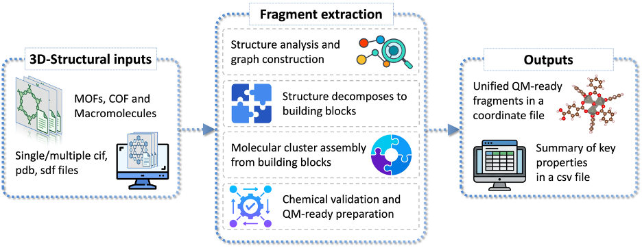

# UniFrag

UniFrag is a Python framework designed to cleanly and robustly extract chemically-meaningful cluster models from Metal-Organic Frameworks (MOFs), Covalent Organic Frameworks (COFs), and Biological Macromolecules (PDBs). It is specifically optimized for creating stable models for Density Functional Theory (DFT) and QM calculations.

<p align="center">
  
</p>

## Features
- **Symmetric Cluster Extraction**: Targets a core metal cluster (e.g., an Mg3 or Ni3 node) and strictly completes all organic ligands bonded to those core metals. Disconnected or grazing organic linkers are gracefully ignored to prevent floating geometries.
- **Intact Organic Linkers**: The bond-graph traversal guarantees that your ligands are pulled completely symmetrically without slicing through covalent bonds.
- **Automatic Valence Capping**: Any carboxylate, phenolic, or bound Oxygen atom that loses at least one metal during extraction is automatically "capped" with an artificial Hydrogen atom placed precisely along the averaged bond vector at 0.96 Å. This creates standard and perfectly neutralized closed-shell clusters automatically!

## Installation
Dependencies:
```bash
pip install pymatgen numpy scipy networkx rdkit moffragmentor
# biological macromolecules (--kind bio) only:
conda install -c conda-forge pdbfixer openmm
```

## Usage
The entry point is `fragmentation_oop.py`. Choose the structure class with `--kind` (`mof` is the default).

```bash
# A folder of structures (batch mode), in parallel
python fragmentation_oop.py <folder_with_cifs> --kind cof --nproc 8

# One structure: (re)processes it into the collection in its own folder
python fragmentation_oop.py <path_to_cif> --kind mof --radius 4.0
```

Results are written to the folder that holds the input (for a single file, its frames in the collection are replaced and the other structures' frames are kept):
- `fragments_collection.extxyz` - all closed-shell fragments, one frame each. The comment line carries `label=`, `charge=` (0 for every fragment) and, where recorded, `capped_h=` (indices of the hydrogens UniFrag added).
- `fragmentation_summary.csv` - one row per structure, with normal and minimized fragment sizes and whether each was a duplicate of an earlier one.
- `fragments_quarantine.extxyz` - open-shell fragments the parity repair could not close; they are kept out of the collection.
- `prescan_quarantine/` and `timed_out_structures/` - input files rejected by the parent pre-scan or stopped by `--timeout`.

A folder run resumes where it stopped; pass `--overwrite` to start again from scratch.

### Arguments
- `input_path`: A `.cif` file (`.pdb` for `--kind bio`), or a folder of them.
- `--kind`: `mof`, `cof` or `bio` (default `mof`).
- `--nproc`: Number of parallel processes in folder mode (default 1).
- `--timeout`: Seconds allowed per structure before it is moved to `timed_out_structures/` (default 300; 0 disables).
- `--overwrite`: In folder mode, discard previous results instead of resuming.
- `--cof-layer`: For layered COFs, `auto`, `monomer` or `dimer` (default `auto`).
- `--center`: The atomic index in the unit cell that acts as the physical origin. Leave it blank (or set to `-1`) and the script will automatically lock onto the most centralized metal atom to avoid periodic boundary wrapping.
- `--radius`: The spatial sphere (in Ångströms) defining the central "core metals". **Radius = 4.0 Å is highly recommended** for MOF-74 analogues to consistently isolate precisely 3 core metal atoms. *Warning: Radii larger than 4.5 Å will trigger a structural warning as they may disrupt molecular symmetries depending on your specific MOF lattice.*
- `--nmetals`: Number of core metals to target (MOF, default 3).

A "minimized" fragment is produced automatically whenever the normal fragment exceeds 50 atoms. (`--output` and `--minimize` are still accepted on the command line but are currently not used.)

## Example
If you want to extract a 4-linker, 3-Metal core out of an MOF-74 variant:
```bash
python fragmentation_oop.py example/MgMOF74_clean_fromCORE.cif --kind mof --radius 4.0
```
The fragments are written to `example/fragments_collection.extxyz`.

## Biological Macromolecules (MacromolFragmenter)

UniFrag now supports the fragmentation of single-chain biological macromolecules (proteins) using a sequence-based sliding window approach. This is ideal for extracting contiguous peptide segments for QM calculations.

**Key Features:**
- **Sliding Window:** Iterates along the backbone sequence using `--window-size` and `--stride` to produce well-defined fragments without relying on spatial radii.
- **Strict Neutralization:** Biological fragments are strictly neutralized for QM calculations. The internal bond graph automatically detects charged functional groups at pH 7 (e.g., carboxylates, ammonium, guanidinium, imidazolium) and adds or removes single Hydrogen atoms to enforce a formal charge of exactly **0**.
- **Cut-Bond Only Capping:** Heavy atoms are taken directly from the PDB coordinates and are never modified. Only the severed peptide bonds at the N- and C-terminal cuts are capped with single Hydrogen atoms.
- **PDBFixer Integration:** Automatically runs `pdbfixer` to resolve missing residues, missing heavy atoms, and missing native Hydrogens at a physiological pH before fragmentation begins.
- **Chemical Deduplication:** Uses a strict chemical fingerprint to detect and skip writing redundant `.xyz` files when highly repetitive sequences produce identical geometries.

### Usage
Run the fragmentation script specifying `--kind bio`. You can process individual PDB files or entire directories using the shell runner.

```bash
# Process a single PDB file with window size 5, stride 1, and pH 7.0
python fragmentation_oop.py example_protein.pdb --kind bio --window-size 5 --stride 1 --ph 7.0

# Process an entire directory of PDBs using the shell helper
./run_bio_family.sh test_on_bio_mol 5 1 7.0
```

### Bio Arguments
- `--window-size`: Number of amino acid residues to include in each fragment (default: 5). **Decrease this number to reduce the total number of atoms in your fragments.**
- `--stride`: The step size in residues between consecutive windows (default: 1).
- `--ph`: The physiological pH to use when PDBFixer adds missing hydrogens (default: 7.0).
- `--no-pdbfixer`: Skip the PDBFixer pre-processing step and use the original raw PDB file directly.
